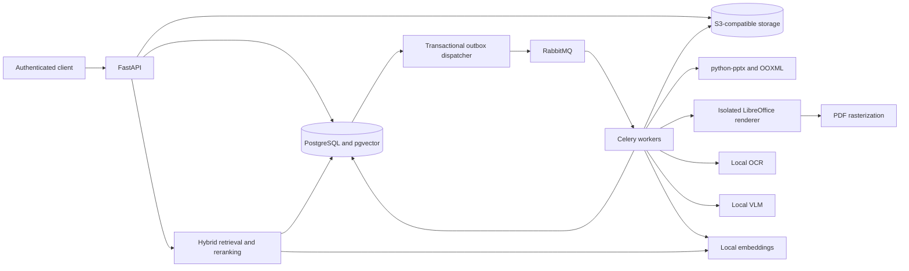
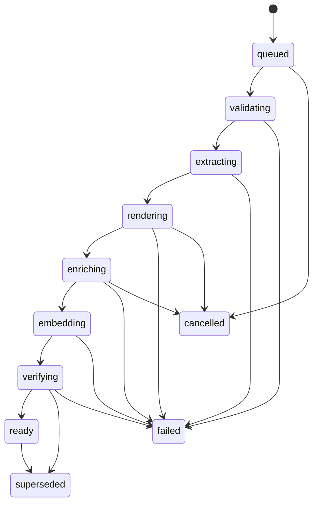

# PowerPoint slide searcher technical design

Status: proposed implementation specification, revision 1.0.

Date: 2026-11-07.

Audience: implementers, reviewers, operators, and Codex agents.

## 1. Purpose and design basis

Build an on-premises service that ingests PowerPoint files and returns the slides that match a user's text query. Queries can refer to native text, text inside screenshots, clip art, colors, charts, diagrams, or visual relationships. Results include the presentation, slide number, preview, evidence, and matching object locations.

This specification expands the architecture retrieved from the referenced **PowerPoint Search Pipeline** conversation. It preserves its central decisions:

- Treat a slide as both a structured document and an image.
- Index slides and meaningful objects separately, then return slide results.
- Keep native text, generated descriptions, and their embeddings distinct.
- Combine lexical and semantic retrieval with reciprocal rank fusion, then rerank.
- Start with PostgreSQL, pgvector, and object storage. Evaluate direct visual retrieval later.

The on-premises requirement changes the earlier cloud-model examples to local inference. All thresholds, limits, and performance targets below are proposed defaults, not measured performance. Current primary documentation was checked for key integration details. Section 18 records the references and the remaining validation work.

## 2. Goals, non-goals, and assumptions

### 2.1 Goals

1. Ingest valid `.pptx` files through an authenticated API.
2. Extract slide text, tables, notes, chart labels, pictures, groups, and geometry.
3. Render every slide, recover image text with OCR, and generate visual descriptions.
4. Find semantic paraphrases and visual concepts such as "blue rocket" or "three servers connected to a database."
5. Preserve provenance so results distinguish extracted content from model inference.
6. Enforce presentation permissions before any candidate enters fusion or reranking.
7. Resume interrupted work without duplicate searchable records or partial publications.
8. Operate without outbound network access after dependencies and model weights are provisioned.

### 2.2 Non-goals for the first release

- Editing slides, reconstructing editable objects, or exporting a new slide deck.
- Answer generation, autonomous agents over slide content, or executing embedded content.
- Legacy `.ppt`, encrypted decks, password recovery, `.pptm`, and remote URL ingestion.
- Video or audio transcription, animation timelines, and dynamic OLE evaluation.
- Guaranteed PowerPoint-identical rendering or perfect recognition of every icon.
- Image uploads as search queries, ColPali-style multivector retrieval, or a separate vector database.
- Independent object permissions. Objects inherit their presentation's permissions.

### 2.3 Starting assumptions

| Item | Proposed baseline |
|---|---|
| Corpus | 100,000 active slides; test growth at 1 million |
| Workload | 20 concurrent search users; ingestion is asynchronous |
| Content | English first; retain Unicode and language metadata for later expansion |
| Upload limits | 200 MiB compressed, 2 GiB expanded, 1,000 slides, 20,000 ZIP entries |
| Image limits | 40 megapixels per decoded input image; bounded decoder memory |
| Query limits | 2,000 Unicode characters; model token limits also apply |
| Identity | Existing OIDC provider; stable tenant, user, and group identifiers |
| Inference | Local embedding service; local VLM on an available GPU |
| Notes | Included by default; an administrator may exclude them through a policy visible to uploaders |
| Hidden slides | Retained but excluded from search by default |
| Versions | One active, fully published index generation per presentation |

Validate these assumptions in milestone 0. Hardware, font availability, language coverage, retention policy, and the licensed model choices must be recorded before production rollout. Do not turn unresolved capacity assumptions into performance claims.

## 3. Architecture and component ownership



| Component | Choice and responsibility |
|---|---|
| HTTP service | FastAPI with validated request and response models; auth, uploads, status, search, and authorized downloads |
| Structural extraction | python-pptx for supported structures; focused OOXML relationship readers for unsupported content |
| Renderer | LibreOffice headless to PDF, then Poppler to slide PNGs; separate restricted process/container |
| OCR | Tesseract baseline; benchmark PaddleOCR only if the screenshot evaluation requires it |
| VLM | One locally hosted, licensed model with image input and bounded JSON output |
| Embeddings | Local `intfloat/multilingual-e5-base` baseline, pinned to an immutable revision |
| Database | PostgreSQL with pgvector; SQL migrations; FTS for lexical ranking |
| Binary storage | An approved S3-compatible service; immutable objects and private buckets |
| Queue | Celery workers with RabbitMQ; PostgreSQL owns durable job state |
| Reranker | Optional local text cross-encoder after fusion; deterministic fusion fallback |
| Telemetry | Structured logs, OpenTelemetry traces, Prometheus-compatible metrics |

Use durable workers for ingestion. FastAPI's documentation distinguishes small in-process background work from heavier distributed processing. Do not use request-process background tasks as the durable ingestion mechanism. [FastAPI background tasks](https://fastapi.tiangolo.com/tutorial/background-tasks/)

Deploy separate worker pools for parsing, rendering, OCR, and GPU inference. A deployment may initially share a process image, but rendering and GPU concurrency need independent limits. RabbitMQ is a delivery mechanism, not the source of truth for completion.

## 4. Content extraction and provenance

### 4.1 Validate and inspect the package

Stream uploads into private quarantine storage while computing SHA-256. Validate size, ZIP signatures, required OOXML parts, content types, entry count, expanded sizes, and compression ratios. Reject path traversal and duplicate ZIP names. Never unpack a file using unchecked archive paths.

Reject encrypted or macro-enabled packages with a typed error. Scan uploads with the organization's malware scanner before parsing. Disable XML external entities and DTD processing. Do not follow external OOXML relationships, load external images, run macros, or open embedded executables. The file extension alone is insufficient validation.

### 4.2 Extract native structures first

Traverse presentation relationships in presentation order, rather than sorting filenames such as `slide10.xml`. Store the stable part name and one-based slide number within the generation. These identifiers do not imply identity across revisions.

Extract:

- Slide size, hidden status, title, paragraphs, runs, and table cells.
- Recursive group children, pictures, AutoShapes, connectors, and picture alternative text.
- Speaker notes by default through a policy-controlled path. Exclude notes-master placeholders such as slide images, slide numbers, and dates. Show the active policy to uploaders.
- Chart titles, series labels, categories, and cached values when available.
- SmartArt text and relationships from OOXML where implemented.
- Asset bytes and media type, original shape identifiers, rotation, and group ancestry.

Keep unsupported chart, SmartArt, SVG, EMF, WMF, and OLE metadata even if extraction is incomplete. Use the full-slide render as the fallback source of visible content. Do not claim that python-pptx exposes every PowerPoint object type. Its documented purpose includes reading presentations and extracting indexing content. [python-pptx documentation](https://python-pptx.readthedocs.io/en/latest/)

### 4.3 Preserve usable geometry

Store raw OOXML coordinates in the object metadata and a clipped axis-aligned bounding box in normalized slide coordinates. Apply group transforms, flips, and rotation before computing the visible box. Record the transform and whether the box is exact, approximate, or inferred.

For a rendered image of width `W` and height `H`, crop pixels from normalized coordinates using floor for the top-left corner and ceil for the bottom-right corner. Clip all bounds. Reject zero-area crops. Boxes for rotated objects enclose the rotated shape and may include neighboring pixels.

An extracted image's full bytes are not necessarily what the slide displays. Picture cropping, transparency, masks, and overlays affect appearance. Use the rendered crop for appearance descriptions. Keep the original image separately for provenance and OCR when useful.

### 4.4 Render every slide

Convert the deck to PDF in a dedicated temporary directory with a unique LibreOffice user profile per job. Invoke the executable with an argument list, without shell interpolation. Apply a wall-clock timeout, process-tree kill, memory and CPU limits, and no network access.

The conversion interface uses `--convert-to` and an explicit output directory. Use the presentation PDF export filter supported by the pinned installation. [LibreOffice conversion filters](https://help.libreoffice.org/latest/en-US/text/shared/guide/convertfilters.html)

Rasterize PDF pages to PNG with a 1,920-pixel long edge while preserving the actual slide aspect ratio. Produce a 480-pixel preview. Store PDF and PNG hashes, dimensions, renderer version, font-manifest hash, and conversion warnings.

Verify that rendered page count and slide order match extracted slides, including hidden slides. Configure and test hidden-slide export explicitly. A mismatch blocks publication. Missing fonts or unsupported effects produce a quality warning for review. Rendering fidelity is a corpus-dependent limitation.

### 4.5 OCR and text reconciliation

OCR the rendered slide and meaningful screenshot crops. Retain engine version, language, line text, boxes, and engine confidence. Confidence is an engine output, not a calibrated probability of correctness.

Normalize whitespace and Unicode for indexing while retaining original text. Deduplicate OCR lines against overlapping native text using normalized text similarity and geometry. Never erase native text because OCR disagrees. Keep conflicting OCR as separate evidence with its source. Do not infer exact chart values from pixels when cached chart values are available.

### 4.6 Choose meaningful visual objects

Start with native pictures, groups, charts, and sizeable vector regions. Describe coherent groups before their children. Skip empty placeholders, invisible elements, and tiny decorative fragments. Keep skipped-object metadata for debugging.

Proposed initial limits are 30 described regions per slide and a minimum crop area of 0.5% of the slide. Always retain the full-slide description. Prefer an object's group to many small child shapes. Record truncation when a slide exceeds the cap. Repeated master logos can be suppressed by position and asset hash, but must remain retrievable if explicitly enabled by policy.

Objects embedded inside a screenshot are not native PowerPoint shapes. The baseline can describe them through the screenshot crop and slide caption, but cannot guarantee individual bounding boxes. Add an object detector only if labeled evaluation shows that this gap matters. The API marks inferred boxes and omits fabricated coordinates.

### 4.7 Generate bounded visual descriptions

The VLM receives a slide or crop image and a fixed extraction instruction. Treat any text inside the image as untrusted document content. The model cannot call tools, fetch URLs, change permissions, or write arbitrary database fields.

Validate output against a versioned schema. A representative response is:

```json
{
  "schema_version": "visual-v1",
  "description": "A blue rocket points upward beside a cloud symbol.",
  "objects": [
    {"label": "rocket", "color": "blue", "orientation": "upward"}
  ],
  "relationships": [
    {"subject": "rocket", "relation": "beside", "object": "cloud"}
  ],
  "inferred_meaning": ["possible product launch metaphor"],
  "uncertainties": ["small labels are unreadable"]
}
```

Separate observed appearance from inferred business meaning. Embed observable descriptions by default. Do not use inferred meaning for exact-match evidence. Reject oversized outputs, unknown schema versions, malformed JSON, and invented references. Retry a malformed response once, then record the stage failure or warning according to the publication policy.

## 5. Representations, chunks, and model versions

Each slide has distinct retrieval channels:

| Channel | Indexed content | Retrieval unit |
|---|---|---|
| Native text | Title, body, tables, and chart labels | Text segment mapped to slide |
| Notes | Speaker-note paragraphs, included by default | Note segment mapped to slide |
| OCR | Nonduplicate screenshot and diagram labels | OCR segment mapped to slide or object |
| Slide visual | Description and observed relationships | Slide description segment |
| Object visual | Description, attributes, nearby native labels | Object description segment mapped to slide |

Store these as normalized segments with provenance, not a single opaque paragraph. Keep the title in each body chunk's embedding input, but do not repeat the title in stored body text.

Use the E5 model's `query: ` and `passage: ` input prefixes, normalized output, and 768-dimensional vectors. Its model card documents 768 dimensions and truncation at 512 tokens. Count tokens using the pinned tokenizer. [Multilingual E5 base model card](https://huggingface.co/intfloat/multilingual-e5-base)

Start with chunks of up to 350 content tokens and 50 tokens of overlap, leaving room for titles and prefixes. Split by paragraph, table row group, or OCR line group before applying token windows. Store chunk order, source offsets, and input hash. Cap a single notes section at a configurable budget and record truncation. Never silently truncate model inputs.

A model profile includes model identifier, immutable weights revision, tokenizer revision, dimensions, pooling, normalization, prefixes, and input-format revision. The pipeline fingerprint also includes parser, renderer, fonts, OCR, VLM, prompt, and chunker revisions.

Cache reusable inference outputs by tenant, input hash, stage configuration, and model revision. Cache context-free image descriptions separately from context-dependent object descriptions. Identical crop bytes in different slides may have different meanings. Do not deduplicate presentations across tenants or disclose whether another tenant has the same file.

One active embedding profile is used per corpus release. Backfill a new profile into a separate generation and switch only after validation. Never compare vectors from different model revisions, even if dimensions match. A dimension change requires a new embedding table and index migration.

Direct image encoders and multivector document retrievers remain later experiments. They need independent storage, model-space compatibility, evaluation, and capacity estimates. They must not be inserted into the text vector column.

## 6. Normalized database schema

### 6.1 Schema conventions

The following PostgreSQL DDL is a migration starting point, not a claim of an executed migration. UUIDs are allocated by the application. All timestamps are UTC. Core relational ownership uses foreign keys. JSONB is limited to variable extraction evidence and stage manifests.

`presentation` is the permission boundary. `generation` is an immutable searchable build of a source revision with a specific pipeline fingerprint. A failed generation never replaces the active one. Related records inherit the tenant by joining to their presentation. Application code must never assume that knowing a UUID grants access.

```sql
CREATE EXTENSION IF NOT EXISTS vector;

CREATE TABLE tenant (
    id uuid PRIMARY KEY,
    name text NOT NULL
);

CREATE TABLE presentation (
    id uuid PRIMARY KEY,
    tenant_id uuid NOT NULL REFERENCES tenant(id),
    owner_subject text NOT NULL,
    filename text NOT NULL,
    title text NOT NULL DEFAULT '',
    acl_version bigint NOT NULL DEFAULT 1,
    created_at timestamptz NOT NULL DEFAULT now(),
    deleted_at timestamptz
);
CREATE INDEX presentation_tenant_idx ON presentation(tenant_id);

CREATE TABLE presentation_grant (
    presentation_id uuid NOT NULL REFERENCES presentation(id) ON DELETE CASCADE,
    principal_type text NOT NULL CHECK (principal_type IN ('user', 'group')),
    principal_id text NOT NULL,
    permission text NOT NULL CHECK (permission IN ('read', 'write', 'admin')),
    PRIMARY KEY (presentation_id, principal_type, principal_id)
);
CREATE INDEX grant_lookup_idx
    ON presentation_grant(principal_type, principal_id, presentation_id);

CREATE TABLE blob (
    id uuid PRIMARY KEY,
    tenant_id uuid NOT NULL REFERENCES tenant(id),
    sha256 text NOT NULL CHECK (sha256 ~ '^[0-9a-f]{64}$'),
    media_type text NOT NULL,
    byte_size bigint NOT NULL CHECK (byte_size >= 0),
    object_key text NOT NULL UNIQUE,
    created_at timestamptz NOT NULL DEFAULT now(),
    UNIQUE (tenant_id, sha256)
);

CREATE TABLE source_revision (
    id uuid PRIMARY KEY,
    presentation_id uuid NOT NULL REFERENCES presentation(id) ON DELETE CASCADE,
    revision_number integer NOT NULL CHECK (revision_number > 0),
    original_blob_id uuid NOT NULL REFERENCES blob(id),
    created_at timestamptz NOT NULL DEFAULT now(),
    UNIQUE (presentation_id, revision_number),
    UNIQUE (id, presentation_id)
);

CREATE TABLE model_profile (
    id text PRIMARY KEY,
    model_name text NOT NULL,
    weights_revision text NOT NULL,
    dimensions integer NOT NULL CHECK (dimensions = 768),
    config jsonb NOT NULL,
    UNIQUE (model_name, weights_revision, config)
);

CREATE TABLE generation (
    id uuid PRIMARY KEY,
    presentation_id uuid NOT NULL,
    source_revision_id uuid NOT NULL,
    build_number bigint NOT NULL CHECK (build_number > 0),
    pipeline_fingerprint text NOT NULL,
    model_profile_id text NOT NULL REFERENCES model_profile(id),
    state text NOT NULL CHECK (state IN
        ('queued', 'validating', 'extracting', 'rendering', 'enriching',
         'embedding', 'verifying', 'ready', 'failed', 'cancelled', 'superseded')),
    quality text CHECK (quality IN ('complete', 'degraded')),
    warnings jsonb NOT NULL DEFAULT '[]'::jsonb,
    created_at timestamptz NOT NULL DEFAULT now(),
    published_at timestamptz,
    FOREIGN KEY (source_revision_id, presentation_id)
        REFERENCES source_revision(id, presentation_id) ON DELETE CASCADE,
    UNIQUE (presentation_id, build_number),
    UNIQUE (source_revision_id, pipeline_fingerprint),
    UNIQUE (id, presentation_id),
    UNIQUE (id, model_profile_id)
);

CREATE TABLE active_generation (
    presentation_id uuid PRIMARY KEY REFERENCES presentation(id) ON DELETE CASCADE,
    generation_id uuid NOT NULL UNIQUE,
    FOREIGN KEY (generation_id, presentation_id)
        REFERENCES generation(id, presentation_id)
);

CREATE TABLE slide (
    id uuid PRIMARY KEY,
    generation_id uuid NOT NULL REFERENCES generation(id) ON DELETE CASCADE,
    slide_number integer NOT NULL CHECK (slide_number > 0),
    source_part text NOT NULL,
    title text NOT NULL DEFAULT '',
    hidden boolean NOT NULL DEFAULT false,
    width_emu bigint NOT NULL CHECK (width_emu > 0),
    height_emu bigint NOT NULL CHECK (height_emu > 0),
    preview_blob_id uuid REFERENCES blob(id),
    render_blob_id uuid REFERENCES blob(id),
    UNIQUE (generation_id, slide_number),
    UNIQUE (id, generation_id)
);

CREATE TABLE slide_object (
    id uuid PRIMARY KEY,
    slide_id uuid NOT NULL REFERENCES slide(id) ON DELETE CASCADE,
    parent_object_id uuid,
    source_key text NOT NULL,
    object_type text NOT NULL,
    x double precision NOT NULL,
    y double precision NOT NULL,
    width double precision NOT NULL,
    height double precision NOT NULL,
    bbox_source text NOT NULL CHECK (bbox_source IN ('native', 'approximate', 'inferred')),
    asset_blob_id uuid REFERENCES blob(id),
    crop_blob_id uuid REFERENCES blob(id),
    evidence jsonb NOT NULL DEFAULT '{}'::jsonb,
    UNIQUE (slide_id, source_key),
    UNIQUE (id, slide_id),
    FOREIGN KEY (parent_object_id, slide_id) REFERENCES slide_object(id, slide_id),
    CHECK (x >= 0 AND y >= 0 AND width > 0 AND height > 0),
    CHECK (x + width <= 1.000001 AND y + height <= 1.000001)
);

CREATE TABLE segment (
    id uuid PRIMARY KEY,
    slide_id uuid NOT NULL,
    generation_id uuid NOT NULL,
    object_id uuid,
    channel text NOT NULL CHECK (channel IN
        ('native', 'ocr', 'slide_visual', 'object_visual', 'notes')),
    source_key text NOT NULL,
    ordinal integer NOT NULL CHECK (ordinal >= 0),
    language text NOT NULL DEFAULT 'und',
    text_content text NOT NULL,
    input_sha256 text NOT NULL,
    provenance jsonb NOT NULL DEFAULT '{}'::jsonb,
    search_vector tsvector GENERATED ALWAYS AS
        (to_tsvector('simple'::regconfig, text_content)) STORED,
    FOREIGN KEY (slide_id, generation_id)
        REFERENCES slide(id, generation_id) ON DELETE CASCADE,
    FOREIGN KEY (object_id, slide_id) REFERENCES slide_object(id, slide_id),
    UNIQUE (slide_id, source_key, ordinal),
    UNIQUE (id, generation_id)
);
CREATE INDEX segment_fts_idx ON segment USING gin(search_vector);
CREATE INDEX segment_slide_idx ON segment(slide_id);
CREATE INDEX segment_generation_channel_idx ON segment(generation_id, channel);
CREATE INDEX object_slide_idx ON slide_object(slide_id);

CREATE TABLE text_embedding (
    segment_id uuid PRIMARY KEY,
    generation_id uuid NOT NULL,
    model_profile_id text NOT NULL,
    embedding vector(768) NOT NULL,
    FOREIGN KEY (segment_id, generation_id)
        REFERENCES segment(id, generation_id) ON DELETE CASCADE,
    FOREIGN KEY (generation_id, model_profile_id)
        REFERENCES generation(id, model_profile_id) ON DELETE CASCADE
);
CREATE INDEX embedding_cosine_idx
    ON text_embedding USING hnsw (embedding vector_cosine_ops);
CREATE INDEX embedding_generation_idx ON text_embedding(generation_id);

CREATE TABLE stage_task (
    id uuid PRIMARY KEY,
    generation_id uuid NOT NULL REFERENCES generation(id) ON DELETE CASCADE,
    stage text NOT NULL,
    unit_key text NOT NULL,
    status text NOT NULL CHECK (status IN
        ('pending', 'running', 'retry_wait', 'succeeded', 'failed', 'cancelled')),
    attempt integer NOT NULL DEFAULT 0 CHECK (attempt >= 0),
    lease_token uuid,
    lease_expires_at timestamptz,
    next_attempt_at timestamptz,
    output_manifest jsonb,
    error_code text,
    error_detail text,
    updated_at timestamptz NOT NULL DEFAULT now(),
    UNIQUE (generation_id, stage, unit_key)
);
CREATE INDEX task_dispatch_idx ON stage_task(status, next_attempt_at);

CREATE TABLE outbox (
    id uuid PRIMARY KEY,
    task_id uuid NOT NULL REFERENCES stage_task(id) ON DELETE CASCADE,
    dispatch_number integer NOT NULL,
    payload jsonb NOT NULL,
    available_at timestamptz NOT NULL DEFAULT now(),
    published_at timestamptz,
    UNIQUE (task_id, dispatch_number)
);
CREATE INDEX outbox_pending_idx ON outbox(available_at)
    WHERE published_at IS NULL;

CREATE TABLE api_idempotency (
    tenant_id uuid NOT NULL REFERENCES tenant(id),
    subject text NOT NULL,
    operation text NOT NULL,
    key text NOT NULL,
    request_sha256 text NOT NULL,
    response jsonb,
    expires_at timestamptz NOT NULL,
    PRIMARY KEY (tenant_id, subject, operation, key)
);

CREATE TABLE audit_event (
    id uuid PRIMARY KEY,
    tenant_id uuid NOT NULL REFERENCES tenant(id),
    actor_subject text NOT NULL,
    action text NOT NULL,
    resource_id uuid,
    occurred_at timestamptz NOT NULL DEFAULT now(),
    detail jsonb NOT NULL DEFAULT '{}'::jsonb
);
```

### 6.2 Required invariants outside the base DDL

Implement these checks in shared transaction code and cover them with integration tests. Add constraint triggers where direct database writers make application checks insufficient:

- A blob reference must belong to the same tenant as its owning presentation.
- A parent object must not form a cycle. Extraction writes parents before children.
- An `object_visual` segment requires an object. A `slide_visual` segment has no object.
- Embeddings must contain finite values, have nonzero norm, and match the profile's normalization.
- The active pointer can reference only a verified `ready` generation.
- A published generation is immutable. Repairs create a new fingerprinted generation.
- Publication, ACL changes, and soft deletion lock the same presentation row.
- `build_number` and source revision numbers are allocated while holding that lock.

The schema uses `simple` FTS configuration as a predictable Unicode-aware lexical baseline without English stemming. Add a separate language-specific index only after evaluation. FTS is not substring search and `ts_rank_cd` is not BM25. Add a narrowly scoped exact identifier path for punctuation-heavy values such as `AWS::Lambda`, with explicit normalization and bounded matching. [PostgreSQL text-search controls](https://www.postgresql.org/docs/current/textsearch-controls.html)

The HNSW cosine index and query operator must agree. For this schema, use `vector_cosine_ops` and `<=>`, ordered by distance ascending. Keep models isolated by profile and generation. [pgvector documentation](https://github.com/pgvector/pgvector)

## 7. Binary storage and lifecycle

Use private keys of the form `tenants/{tenant_id}/blobs/{sha256}`. Store filenames as metadata, never as filesystem paths. A `blob` row can serve multiple references within one tenant. Use conditional creation or verify an existing object's hash before reuse.

Upload binaries before committing references. An interrupted database transaction may leave an unreferenced object. A garbage collector removes unreferenced objects only after a grace period and a fresh reference check. Never delete shared binary content merely because one presentation was deleted.

Access an image or original through an authorized API endpoint. The endpoint resolves the blob through its presentation and verifies current access. Do not expose arbitrary object keys or provide public bucket URLs. Stream downloads through the API for prompt revocation. If presigned URLs are added later, their expiry creates a documented revocation delay.

Soft deletion immediately removes a deck from retrieval and download access. A retention worker later removes inactive generations, original revisions, and unreferenced blobs under the organization's retention rules. Audit records remain subject to their own policy. Backups need expiry rules too; deleting active storage does not erase historical backups.

## 8. Ingestion state machine and idempotence

### 8.1 Generation states



The diagram summarizes the common path. Cancellation is legal from every nonterminal processing state, including extracting, embedding, and verifying. Retries belong to `stage_task`, so a generation remains in its current stage while a unit retries. A terminal failed generation requires an explicit retry operation, which resets only failed or incomplete tasks. Completed manifests remain reusable.

### 8.2 Stage outputs and publication gates

| Stage | Durable output | Gate |
|---|---|---|
| Validate | Scan result, source checksum, package manifest | All upload checks pass |
| Extract | Slides, objects, native segments, assets | Slide order and geometry pass validation |
| Render | PDF, slide renders, previews, manifest | All slides render and counts match |
| Enrich | OCR and VLM segments with provenance | Mandatory captions exist; warnings classified |
| Embed | Vector per nonempty eligible segment | Expected vector count and model profile match |
| Verify | Counts, checksums, quality report | No dangling records, invalid boxes, or mixed profiles |
| Publish | Active-generation pointer | Atomic transaction and latest-build check |

Default production policy requires native extraction, previews, slide captions, and embeddings for every slide. Object-caption or OCR failures can yield `quality=degraded` only when the configured release policy allows those failures and the API exposes warnings. An image-only slide with failed OCR and no usable caption fails the publication gate. Do not silently call an incomplete generation complete.

### 8.3 Durable execution protocol

1. Commit the stage task and its outbox event in the same PostgreSQL transaction.
2. The dispatcher publishes persistent messages with publisher confirmation, then records publication. A crash between these actions can duplicate delivery.
3. A worker claims a pending or expired task with a row lock and a fresh lease token. A duplicate with a valid lease exits without work.
4. The worker creates immutable binaries and computes its output manifest outside a long-running database transaction.
5. The worker commits rows and completion only if its lease token still matches and the generation has not been cancelled or deleted.
6. The same commit schedules dependent tasks through new outbox records.
7. A periodic reconciler requeues expired leases and undispatched tasks. It checks database state even when the broker reports an empty queue.

Heartbeat leases every 30 seconds and start with a 2-minute lease for ordinary tasks. Longer operations renew the lease. A stale worker must not update rows or publish after another worker owns the task. Use conditional updates on the lease token as a fencing check.

Use upserts on the stable source keys in the DDL. Derive UUIDs deterministically within a generation or persist allocated IDs before fan-out. Repeated extraction must produce the same keys and row counts. A repeated upload with the same idempotency key and request hash returns the original response. A different body under the same key returns `409`.

Keep upload idempotency records for seven days by default. The request hash includes bytes, target presentation, and indexing policy. Identical bytes uploaded as a different presentation remain a separate permission boundary. Within an existing presentation, unchanged bytes and fingerprint reuse the existing generation.

### 8.4 Retry, failure, and cancellation rules

Retry transient inference, storage, and database failures up to five attempts with jittered delays of approximately 5, 20, 60, and 180 seconds. Do not retry malformed packages, unsupported encryption, or deterministic geometry failures. Move exhausted tasks to terminal failure with a stable error code.

Celery tasks must tolerate duplicate execution. Late acknowledgement alone does not guarantee recovery from every worker termination. The database lease reconciler remains necessary. [Celery task acknowledgement and idempotence](https://docs.celeryq.dev/en/stable/userguide/tasks.html)

Cancellation prevents new tasks and publication. Running tasks check cancellation before committing. Deletion invalidates all in-flight generation publication. Stop renderer subprocesses on timeout or cancellation and clean temporary directories without following symlinks.

### 8.5 Publish without stale replacement

Lock the presentation row. Confirm that it is not deleted, the generation is verified, its model profile is active, and its build number is the latest requested build. Update `active_generation` and `published_at` in that transaction. Mark the old generation superseded.

If a newer request exists, mark the completed older build superseded without changing the pointer. If the newer build fails, retain the previous published generation. An administrator can explicitly request a rollback after reviewing its source and profile. Never let arrival order of queue messages choose the active version.

## 9. API contracts

All routes use `/v1`, HTTPS, bearer authentication, and request IDs. Resolve tenant and subjects from verified identity, never from a caller-controlled tenant field. Responses use ISO 8601 UTC timestamps. Unknown or unauthorized resources return the same `404` response. Record the internal distinction in the audit log.

### 9.1 Routes

| Method and route | Request | Success and semantics |
|---|---|---|
| `POST /presentations` | Multipart file; `Idempotency-Key` required | `202`, creates presentation and generation |
| `POST /presentations/{id}/revisions` | Multipart replacement file; write access | `202`, retains old active generation until publication |
| `POST /presentations/{id}/reindex` | JSON pipeline policy; admin access | `202`, creates or reuses generation |
| `GET /presentations/{id}` | None | `200`, metadata, active generation, latest build |
| `GET /jobs/{generation_id}` | None | `200`, stage counts, quality, warnings, safe error |
| `POST /jobs/{generation_id}/retry` | Idempotency key; write access | `202`, retries allowed failed units |
| `POST /jobs/{generation_id}/cancel` | Write access | `202`, cancellation requested |
| `POST /search` | JSON query and filters | `200`, ranked slide results |
| `GET /slides/{slide_id}` | None | `200`, slide detail and provenance |
| `GET /slides/{slide_id}/preview` | None | `200`, authorized image stream |
| `GET /slides/{slide_id}/objects/{object_id}/crop` | None | `200`, authorized crop stream |
| `GET /presentations/{id}/original` | Optional authorized revision ID | `200`, original file stream |
| `PUT /presentations/{id}/permissions` | Full grants list plus expected ACL version | `200`, atomic replacement; `409` on stale version |
| `DELETE /presentations/{id}` | Admin access | `202`, immediately hidden; purge asynchronous |

Return `413` for size limits, `415` for unsupported formats, `422` for invalid fields or query syntax, `429` for quotas, and `503` when no retrieval path is available. A failed asynchronous validation appears in job state, because upload acceptance precedes full parsing.

### 9.2 Upload response

```json
{
  "presentation_id": "c116ef9a-bebc-4a45-9905-0cefda2e063f",
  "generation_id": "f87d6244-fcbb-4b92-b80e-e66fe740d73f",
  "state": "queued",
  "status_url": "/v1/jobs/f87d6244-fcbb-4b92-b80e-e66fe740d73f"
}
```

### 9.3 Search request and response

```json
{
  "query": "blue rocket beside a cloud",
  "limit": 10,
  "filters": {
    "presentation_ids": [],
    "include_hidden": false
  },
  "rerank": true
}
```

`limit` is between 1 and 50. Empty presentation IDs mean all authorized active presentations. Reject unsupported filters. Return the top results only in the initial release; no unstable offset pagination or costly exact total count.

```json
{
  "request_id": "req_123",
  "mode": "hybrid",
  "degraded": false,
  "warnings": [],
  "results": [
    {
      "slide_id": "05b14a87-8c64-4a81-b6d9-98a27aaf81e2",
      "presentation_id": "c116ef9a-bebc-4a45-9905-0cefda2e063f",
      "generation_id": "f87d6244-fcbb-4b92-b80e-e66fe740d73f",
      "slide_number": 7,
      "title": "Cloud migration",
      "filename": "strategy.pptx",
      "preview_url": "/v1/slides/05b14a87-8c64-4a81-b6d9-98a27aaf81e2/preview",
      "score": 0.043,
      "score_type": "rrf",
      "evidence": [
        {
          "source": "object_visual",
          "object_id": "03c15967-1a92-40a9-9b16-c045e0602ccd",
          "text": "Blue rocket beside a cloud symbol.",
          "bbox": {"x": 0.62, "y": 0.28, "width": 0.18, "height": 0.24},
          "bbox_source": "native"
        }
      ]
    }
  ],
  "timings_ms": {"total": 240}
}
```

The score is a ranking value, not a probability. Set `score_type` to `reranker` if reranking succeeds. Preserve fusion scores internally for debugging. Evidence text is source content or a labeled generated description, never a generated claim that an exact term appears in the deck.

Return errors as `{"error":{"code":"unsupported_format","message":"Only PPTX files are supported.","request_id":"req_123"}}`. Do not expose filesystem paths, stack traces, model prompts, or other tenants' identifiers.

## 10. Retrieval, fusion, and reranking

### 10.1 Permission-scoped candidate retrieval

Resolve the user's current groups from the trusted identity system. Define the authorized presentation set once per request and use it inside every retrieval query. For lexical search, a representative query is:

```sql
WITH authorized AS (
    SELECT p.id
    FROM presentation p
    WHERE p.tenant_id = :tenant_id
      AND p.deleted_at IS NULL
      AND (
        p.owner_subject = :subject
        OR EXISTS (
            SELECT 1 FROM presentation_grant g
            WHERE g.presentation_id = p.id
              AND (
                (g.principal_type = 'user' AND g.principal_id = :subject)
                OR (g.principal_type = 'group' AND g.principal_id = ANY(:groups))
              )
        )
      )
)
SELECT s.id AS segment_id, s.slide_id,
       ts_rank_cd(s.search_vector, websearch_to_tsquery('simple', :query)) AS score
FROM authorized a
JOIN active_generation ag ON ag.presentation_id = a.id
JOIN slide sl ON sl.generation_id = ag.generation_id
JOIN segment s ON s.slide_id = sl.id
WHERE (NOT sl.hidden OR :include_hidden)
  AND s.search_vector @@ websearch_to_tsquery('simple', :query)
ORDER BY score DESC, s.id
LIMIT :candidate_limit;
```

Apply requested presentation filters inside the authorized set as an additional intersection. Bind all parameters. Never concatenate query text into SQL. Read/write/admin grants all confer read access; write operations separately require write or admin, and grant changes require owner or admin.

### 10.2 Retrieval algorithm

1. Normalize the query without discarding punctuation needed for exact identifiers. Reject empty text. Do not issue an empty FTS query as a full-corpus scan.
2. Generate one query vector with the active text model profile.
3. Retrieve independent candidate lists for lexical segments, native/OCR semantic segments, slide descriptions, and object descriptions. Start with 50 candidates per list, oversampling chunks when necessary.
4. Join candidates to authorized active generations before ranking them. Vector queries filter profile and channel and order by `embedding <=> :query_vector ASC`.
5. Collapse each channel's hits to one rank per slide using its best matching segment. Keep up to three evidence objects for display. Many matching objects must not produce unlimited votes.
6. Fuse slide ranks with `RRF(slide) = sum(weight[channel] / (60 + rank[channel]))`. Start with weights of 1.0. Ranks start at 1.
7. Rerank the top 30 unique slides using bounded native text, slide captions, and matched-object descriptions. Preserve stable slide-ID tie breaking.
8. Recheck access and deletion status before returning metadata. Return up to the requested limit with current authorized preview routes.

Cross-encoder input must be bounded per candidate. Give each representation a fixed token budget, rather than letting long notes exclude visual evidence. A text reranker cannot inspect pixels; retain visual description evidence and evaluate whether it harms visual queries.

### 10.3 Approximate search and filtered recall

Start with exact vector distance over small authorized subsets and measure it before enabling approximate retrieval. HNSW search with selective filters may return too few matches. Use pgvector's supported iterative scan settings in a pinned compatible release, oversampling, or an exact filtered fallback. Compare filtered ANN results with exact neighbors during evaluation. [pgvector filtering guidance](https://github.com/pgvector/pgvector)

Do not rely on a global top-k followed by application-side permission filtering. That loses authorized matches and can expose forbidden candidates to reranking or telemetry. Query plans must be inspected with realistic permission filters, not only unrestricted examples.

If embedding inference is unavailable, lexical search may return `200` with `mode=lexical`, `degraded=true`, and a warning. If the reranker times out, return fused results with a warning. If all paths fail, return `503`. Do not disguise a backend failure as zero search results.

No generative query expansion is required initially. Add synonyms or exact-identifier normalization only from evaluation failures. Tune weights on a development set and keep the final evaluation set held out.

## 11. Authorization and deployment security

The API verifies token issuer, audience, signature, expiry, and tenant mapping. The subject and group identities are namespaced to their identity provider. Do not accept arbitrary groups from the request body. Short-lived authentication or group-cache invalidation defines how quickly external membership revocation takes effect.

Centralize access checks in the repository/query layer and test every route, including job status, crop downloads, original downloads, evidence snippets, and object matches. Use distinct database roles for migrations, API reads/writes, and workers. The API must not use a superuser or table-owner role.

RLS is recommended as a second boundary for multi-tenant deployments. It requires policies on every exposed table, trusted transaction-local identity context, and tests for connection-pool identity leakage. Table owners and `BYPASSRLS` roles can bypass policies. Do not claim RLS coverage from a policy on `presentation` alone. [PostgreSQL row security](https://www.postgresql.org/docs/current/ddl-rowsecurity.html)

The first release uses explicit permission joins as the mandatory control. If an organization mandates database-level isolation, RLS implementation is a production release gate rather than an implied property of the base DDL.

Do not cache complete search responses initially. Cache query vectors by model profile and query hash only within tenant boundaries. A later results cache must include subject, group-membership version, ACL version, and active-generation version, with invalidation on change.

Run renderers with read-only application files, disposable writable directories, no network, no host mounts, and no credentials. Restrict model services to internal networks. Provision model weights through an approved process and disable arbitrary remote model code. Encrypt storage and backups and use managed secrets. Notes, extracted text, captions, embeddings, and logs are sensitive derived data.

## 12. Observability and operations

### 12.1 Metrics and traces

- Ingestion stage duration, queue age, retry count, lease expirations, failures by stable code, and render failures.
- Slides processed, objects described, OCR lines, input/output tokens, truncations, and cache hit rate.
- Search latency by path, candidate count, underfilled ANN searches, fallback use, and reranker timeout rate.
- Active/inactive generation counts, orphan blobs, index size, database connections, and GPU utilization.
- Denied-access counts and ACL changes without resource content in metric labels.

Trace request to generation to stage task using identifiers. Logs include tenant-safe identifiers, attempt, model revision, and error code. Do not log document text, full queries, image bytes, tokens, or credentials by default. Query collection for evaluation requires an approved, access-controlled policy.

### 12.2 Alerts and runbooks

Alert on queue age above 10 minutes for 15 minutes, ingestion failure rate above 5% over at least 20 jobs, or search error rate above 1% over at least 100 requests. These are initial alert settings to calibrate.

Provide runbooks for a stuck lease, rendering crash, storage outage, model outage, exhausted GPU memory, database saturation, and incorrect active generation. Each runbook must identify how to inspect state, retry safely, and confirm recovery. Never fix a stuck job by deleting arbitrary rows.

Back up PostgreSQL with point-in-time recovery and object storage with documented retention. A restore drill must recover both original files and matching database references. Target an initial recovery point of 24 hours and recovery time of 4 hours, subject to organizational requirements.

### 12.3 Capacity planning

Estimate vector payload as `segments × 768 × 4 bytes` before tuple and index overhead. At 12 segments per slide and 100,000 slides, raw vector values occupy about 3.69 GB in decimal units. HNSW, text, metadata, replicas, and inactive generations add storage beyond this estimate.

Measure render sizes and stage durations on the real corpus. Record deck size, slide count, GPU model, fonts, model revisions, batch sizes, and concurrent users. Separate cold startup from warm inference. Set per-tenant queue quotas and bounded GPU batches to prevent one deck from monopolizing the service.

## 13. Testing and evaluation

### 13.1 Fixture corpus

Maintain licensed, sanitized PPTX fixtures for plain text, tables, grouped clip art, rotations, nested groups, cropped pictures, transparency, SVG/EMF, SmartArt, charts, screenshot text, multilingual labels, hidden slides, notes, missing fonts, duplicate assets, corrupt ZIPs, and external relationships.

Include adversarial fixtures with ZIP traversal, huge expanded sizes, oversized images, malformed XML, prompt-injection text in a slide, unauthorized cross-tenant IDs, and simultaneous revision updates. Do not require exact PNG byte equality across unpinned rendering stacks.

### 13.2 Test layers

| Layer | Required proof |
|---|---|
| Unit | Geometry transforms, stable keys, chunk token budgets, OCR deduplication, RRF, permission predicates |
| Database integration | DDL applies, FK rejection, duplicate tasks, stale lease fencing, transactional outbox, pointer publication |
| Worker integration | Real parser and renderer, bounded subprocess failure, replay after each durable checkpoint |
| API integration | Upload, poll, search, evidence, download, revision replacement, revocation, cancellation, deletion |
| Model contract | Validated JSON, malformed response, timeout fallback, profile mismatch, deterministic fixture adapters |
| Security | Tenant isolation through every path; no external fetch during parse/render; no leaked pooled identity |
| Operational | Backup restore, broker outage recovery, worker crash recovery, model unavailable behavior |

Use deterministic inference adapters for routine CI, plus a smaller scheduled test against the pinned real models. A fake caption test proves orchestration, not visual recognition quality. Keep those claims separate.

### 13.3 Retrieval evaluation

Create an initial set of 200–500 slides and 50–100 queries. Expand to at least 1,000 slides and 150 labeled queries before production acceptance. Split by presentation, rather than random slide, so near-duplicate templates do not leak between tuning and test sets.

Label exact terminology, semantic paraphrases, clip art, color/shape, diagram relationships, OCR screenshots, and hard negatives. Include image-only slides and visually similar slides with different meaning. Record all known relevant slides and optional object boxes. Two reviewers adjudicate ambiguous cases.

Measure:

- Recall@10 as the fraction of labeled relevant slides retrieved in the first ten.
- Hit rate@10 as the fraction of queries with at least one relevant slide in the first ten.
- MRR@10 for the first relevant slide and nDCG@10 for graded relevance.
- Per-category results, zero-hit rate, p50/p95 latency, and ingestion resource use.
- Object localization on labeled native objects, separately from inferred screenshot regions.
- Unauthorized-hit count, which must always be zero.

Compare lexical-only, native-text semantic plus lexical, added slide captions, added object descriptions, and reranking. Add direct-image retrieval only if a held-out improvement justifies storage and operational costs. Report sample counts and uncertainty. Do not treat a gain on ten queries as a general result.

## 14. Acceptance criteria

These are proposed release gates, to confirm against the evaluation corpus and agreed hardware.

| Area | Acceptance requirement |
|---|---|
| Structural extraction | Every supported fixture has the expected slide order, native text, and object ancestry |
| Rendering | 100% slide/page correspondence on valid supported fixtures; every published slide has a preview |
| Search publication | Search sees either the old complete generation or the new complete generation, never a partial build |
| Idempotence | Ten deliveries of each task produce one logical output and unchanged searchable row counts |
| Crash recovery | Crash before and after each durable checkpoint recovers without duplicate publication |
| Version race | Older workers cannot replace a newer requested build or publish after deletion |
| Permissions | Zero forbidden candidates reach fusion, reranking, snippets, downloads, or results in isolation tests |
| Visual search | Visual-query hit rate@10 at least 0.85 on at least 40 held-out visual queries |
| Text search | Exact-term hit rate@10 at least 0.95; semantic hit rate@10 at least 0.85 |
| Overall quality | nDCG@10 at least 0.75; report per-category Recall@10 and MRR@10 |
| Search latency | Warm p95 below 2 seconds without reranking and 4 seconds with reranking at the agreed workload |
| Ingestion throughput | A representative 50-slide deck becomes searchable within 10 minutes on the agreed hardware |
| Failure reporting | All failed stages expose stable safe errors; degraded results are labeled |
| Offline operation | Ingest and search succeed with outbound network blocked after provisioning |
| Restore | Restore test meets the agreed recovery point/time and can preview and search restored slides |

Performance gates require a recorded hardware and workload profile. If that profile is not agreed, milestone 0 is incomplete. Small evaluation samples justify limited claims and must be expanded before broader rollout.

## 15. Phased milestones and concrete tasks

Dependencies run M0, M1, M2, M3, then M4. M5 is optional. Complete the listed evidence before moving to the next milestone.

### M0. Freeze constraints and establish the evaluation baseline

- [ ] Confirm corpus size, languages, concurrent users, retention, notes exclusion override, hidden-slide policy, and identity source.
- [ ] Inventory CPU, RAM, GPU memory, fonts, storage, and approved software/model licenses.
- [ ] Pin runtime, dependencies, container images, model revisions, and tokenizer revisions.
- [ ] Collect sanitized PPTX fixtures and label the first query set.
- [ ] Define the benchmark workload and record hardware details.
- [ ] Verify renderer output and VLM feasibility on ten representative decks.
- [ ] Record baseline stage duration and lexical search results.

Exit evidence: a configuration manifest, licensed fixture inventory, first evaluation report, and resolved production assumptions.

### M1. Deliver durable text ingestion and authorized search

- [ ] Create migrations for tenants, presentations, revisions, generations, tasks, outbox, blobs, slides, objects, and segments.
- [ ] Implement OIDC verification and shared authorization queries.
- [ ] Implement streaming uploads, quarantine, package validation, checksums, and API idempotency.
- [ ] Implement a transactional outbox dispatcher and leased task runner.
- [ ] Extract native text, tables, recursive groups, speaker notes by default, and object metadata.
- [ ] Render PDF and slide previews in the restricted worker.
- [ ] Publish a verified text-only generation under an explicit M1 pipeline fingerprint.
- [ ] Add lexical search, preview streaming, job status, soft deletion, and version replacement.
- [ ] Prove replay safety, broker outage recovery, and denial through all read routes.

Exit evidence: a real fixture uploads, publishes, searches by exact text, previews, and becomes inaccessible after revocation/deletion. M1 is a text-only development milestone, not the completed product.

### M2. Deliver semantic and slide visual search

- [ ] Implement tokenizer-aware chunking and the pinned embedding profile.
- [ ] Add local embedding inference and model contract tests.
- [ ] Add OCR extraction with geometry and native-text reconciliation.
- [ ] Add bounded whole-slide VLM descriptions with validated JSON and provenance.
- [ ] Add vector retrieval by channel and permission scope.
- [ ] Implement per-slide collapse, RRF, and explicit lexical fallback.
- [ ] Reindex M1 decks into a new generation and atomically publish only after verification.
- [ ] Evaluate native-text versus caption-enriched retrieval on held-out queries.

Exit evidence: image-only visual fixtures are found through text descriptions, and all mixed-profile, incomplete-generation, and degradation tests pass.

### M3. Deliver object search and evidence

- [ ] Implement normalized geometry, group transforms, rotation bounds, and rendered crops.
- [ ] Add stable meaningful-object selection and explicit object caps.
- [ ] Extract supported chart and SmartArt evidence through focused OOXML readers.
- [ ] Describe meaningful object crops and embed their descriptions with nearby labels.
- [ ] Resolve object candidates to slides without allowing many objects to multiply channel votes.
- [ ] Return evidence boxes and crop routes with inherited authorization.
- [ ] Add UI or API-client checks for normalized highlight alignment.
- [ ] Evaluate clip-art queries, color/shape queries, and diagram relationships separately.

Exit evidence: "blue rocket" finds the labeled slide and highlights the actual native object; screenshot-internal objects expose only supported localization.

### M4. Prove production readiness

- [ ] Benchmark exact and HNSW retrieval under realistic permission filters.
- [ ] Add filtered-recall fallback and reranker only after evaluation demonstrates value.
- [ ] Complete metrics, alerts, retry/cancel tools, quotas, and operator runbooks.
- [ ] Implement retention, orphan cleanup, audit retention, and backup restore procedures.
- [ ] Complete RLS if required by the deployment's isolation policy.
- [ ] Run hostile-file, prompt-injection, tenant-isolation, and identity-pool tests.
- [ ] Run crash/retry/version-race tests and offline-network tests.
- [ ] Run the expanded held-out evaluation and agreed concurrent workload.
- [ ] Publish the acceptance report with unresolved limits explicitly listed.

Exit evidence: all applicable acceptance gates pass, and an operator restores the system and safely retries a failed ingestion using the runbooks.

### M5. Optional visual retrieval experiments

- [ ] Identify failures that captions and OCR cannot address.
- [ ] Benchmark a local joint image/text encoder on slide renders and object crops.
- [ ] Evaluate image-query support with its own privacy and upload contract.
- [ ] Evaluate multivector page retrieval only for demonstrated diagram/layout failures.
- [ ] Compare held-out quality, storage, latency, and operational cost before proposing a production migration.

Exit evidence: a documented decision to adopt or reject each experiment. No dependency on M5 is allowed in M1–M4.

## 16. Codex implementation guidance

### 16.1 Suggested repository ownership

```text
app/
  api/              # HTTP contracts, authentication dependencies
  domain/           # Generation states, publication rules, errors
  db/               # Migrations and permission-scoped queries
  ingestion/        # Validation, extraction, rendering, enrichment
  workers/          # Leases, task handlers, outbox dispatch
  search/           # Candidate retrieval, collapse, fusion, reranking
  storage/          # Private object access and lifecycle
tests/
  fixtures/         # Sanitized PPTX files and expected evidence
  integration/      # Database, worker, API, security flows
  evaluation/       # Labeled queries and retrieval reports
deploy/             # Local services, pinned images, runtime configuration
docs/               # Runbooks and decision records
```

This is an ownership map, not a requirement to create empty files or wrapper classes. Reuse an existing repository's conventions. Keep pure geometry, chunking, and RRF functions small. Use real integration boundaries for storage, database, rendering, and inference.

### 16.2 Instructions for each implementation task

1. Read this specification and the current repository instructions. Identify the milestone and acceptance gate.
2. Inspect existing callers, schema, fixtures, and deployment configuration before editing.
3. Implement the smallest complete vertical slice. Do not prebuild M5 or a generic plugin system.
4. Include migrations, affected API contracts, authorization paths, and operational configuration in the same task.
5. Test the observable failure mode and the real artifact. A mocked VLM cannot establish visual-search accuracy.
6. Record exact verification commands, environment/profile versions, and any unresolved limitation.
7. Update the task checklist and acceptance report. Do not mark a milestone complete because code exists.

Boundary contracts to implement first are `extract_presentation(source) -> manifest`, `render_presentation(source) -> render_manifest`, `describe(image, profile) -> validated_description`, and `embed(inputs, profile) -> vectors`. Each takes explicit immutable configuration and returns versioned data. Avoid an unrestricted callback framework around these four boundaries.

Configuration must cover database and storage endpoints, private bucket, broker, identity provider, local model endpoints, model revisions, worker concurrency, upload limits, notes policy, timeouts, retry limits, and retention. Secrets come from the deployment secret store. Commit an example containing names and safe defaults only.

### 16.3 Definition of done for every slice

- [ ] Required behavior works on a real fixture or a running service.
- [ ] Current authorization applies to every new read and write path.
- [ ] Duplicate delivery and interruption do not corrupt durable state.
- [ ] Schema and API changes include compatibility/migration treatment.
- [ ] Failures expose stable safe error codes and useful operator telemetry.
- [ ] Relevant milestone tests pass; measured claims include workload and hardware.
- [ ] Deferred work is identified with a concrete condition for revisiting it.

## 17. Tradeoffs and unresolved decisions

| Decision | Baseline | Revisit when |
|---|---|---|
| Database count | PostgreSQL for metadata, FTS, vectors | Proven capacity or query-plan limits justify another engine |
| Visual understanding | Captions plus text embeddings | Held-out visual failures justify direct-image retrieval |
| Localization | Native objects and coherent groups | Screenshot-internal localization is a product requirement |
| Version refresh | Rebuild a generation; reuse cached inference | Measured rebuild cost justifies incremental slide matching |
| Object caps | 30 described regions per slide | Evaluation shows meaningful objects are consistently omitted |
| OCR engine | Local Tesseract | Screenshot/language evaluation requires a stronger local engine |
| VLM selection | A pinned local model chosen in M0 | Quality, GPU fit, or license fails deployment requirements |
| Reranking | Optional local cross-encoder | Measured relevance gain exceeds latency and capacity cost |
| Notes | Included by default; administrator exclusion override is visible to uploaders | Organization policy requires exclusion or per-tenant control |

The largest remaining risks are rendering differences, VLM omission or hallucination, and permission-filtered vector recall. Provenance, visible quality warnings, exact-search comparisons, and held-out evaluation address these risks without promising perfect extraction.

## 18. References and verification status

The earlier assistant architecture was retrieved from the supplied conversation on 2026-11-07. It is the conceptual source, not a package/API reference. External references below were inspected for this specification. They do not establish that this proposed implementation has been built or benchmarked.

- [python-pptx documentation](https://python-pptx.readthedocs.io/en/latest/) for presentation reading and supported content.
- [LibreOffice conversion filters](https://help.libreoffice.org/latest/en-US/text/shared/guide/convertfilters.html) for conversion interface details.
- [FastAPI background tasks](https://fastapi.tiangolo.com/tutorial/background-tasks/) for durable-worker separation.
- [Celery tasks](https://docs.celeryq.dev/en/stable/userguide/tasks.html) for duplicate execution and acknowledgement caveats.
- [PostgreSQL text-search controls](https://www.postgresql.org/docs/current/textsearch-controls.html) for query parsing and lexical ranking.
- [PostgreSQL row security](https://www.postgresql.org/docs/current/ddl-rowsecurity.html) for RLS scope and bypass behavior.
- [pgvector documentation](https://github.com/pgvector/pgvector), also retrieved through Context7, for vector indexes, cosine operators, and filtered search.
- [Multilingual E5 base model card](https://huggingface.co/intfloat/multilingual-e5-base) for dimensions, prefixes, and input length.

Before implementation, resolve current library documentation for the exact pinned versions. Before production, execute the DDL against the selected PostgreSQL/pgvector images, exercise the real S3-compatible service and queue, verify renderer fidelity, validate model licenses, and run the acceptance suite. None of those runtime checks were performed while authoring this document.
